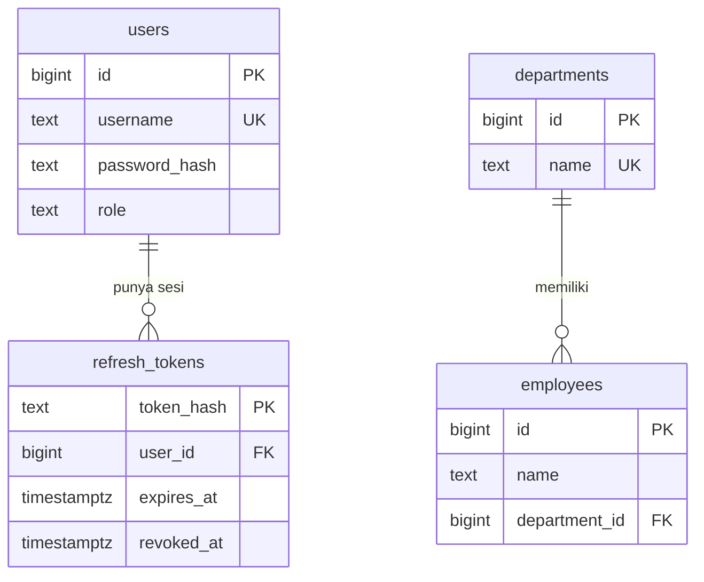

# Entity Relationship Diagram

Database aplikasi adalah PostgreSQL 16, database `amerta`. Schema mengikuti
`db/init/001_init.sql`. Tidak ada relasi antara akun login dan data organisasi:
baris di `users` bukan baris di `employees`.

Dua kelompok tabel berdiri sendiri:

| Kelompok | Tabel | Arti |
| -------- | ----- | ---- |
| Autentikasi | `users`, `refresh_tokens` | Akun yang bisa login dan sesi refresh-nya |
| Organisasi | `departments`, `employees` | Departemen dan karyawan yang tercatat di dalamnya |

## Diagram

Notasi kaki gagak:

- `||` = tepat satu
- `o{` = nol atau banyak

Satu user boleh belum punya refresh token, atau punya banyak (login berulang;
token lama yang sudah dicabut tetap tersimpan). Satu refresh token milik tepat
satu user. Satu departemen boleh kosong. Satu karyawan wajib milik tepat satu
departemen.

## Kardinalitas dan penghapusan

| Dari | Ke | Kardinalitas | Foreign key | Saat induk dihapus |
| ---- | -- | ------------ | ----------- | ------------------ |
| `users` | `refresh_tokens` | 1 : 0..N | `refresh_tokens.user_id` → `users.id` | `ON DELETE CASCADE`. Semua token user ikut terhapus. |
| `departments` | `employees` | 1 : 0..N | `employees.department_id` → `departments.id` | Tanpa klausa `ON DELETE` → perilaku default PostgreSQL `NO ACTION`. API mengecek dulu dan membalas 409 bila masih ada karyawan. |

Tidak ada foreign key lain. Menghapus user tidak menyentuh departemen atau
karyawan.

## Kamus kolom

### `users`

Akun yang dipakai login. Role dibaca ulang dari tabel ini pada setiap request;
JWT access token hanya menyimpan id user di klaim `sub`.

| Kolom | Tipe | Wajib | Aturan database | Validasi aplikasi |
| ----- | ---- | ----- | --------------- | ----------------- |
| `id` | `BIGSERIAL` | ya | Primary key | — |
| `username` | `TEXT` | ya | Unik. `CHECK (username = lower(username))` | Dinormalisasi ke huruf kecil. Pola `^[a-z0-9._-]{3,32}$` saat create. |
| `password_hash` | `TEXT` | ya | — | Hash bcrypt (cost 12). Password mentah 6–72 karakter saat create; tidak dikirim API. |
| `role` | `TEXT` | ya | Default `'user'`. `CHECK (role IN ('admin', 'user'))` | Hanya `admin` atau `user`. |

### `refresh_tokens`

Sesi jangka panjang. Yang disimpan adalah hash token, bukan token mentah.

| Kolom | Tipe | Wajib | Aturan |
| ----- | ---- | ----- | ------ |
| `token_hash` | `TEXT` | ya | Primary key. SHA-256 (hex) dari refresh token acak. |
| `user_id` | `BIGINT` | ya | Foreign key ke `users.id`. |
| `expires_at` | `TIMESTAMPTZ` | ya | Token ditolak bila sudah lewat, meski belum dicabut. |
| `revoked_at` | `TIMESTAMPTZ` | tidak | `NULL` = masih aktif. Diisi `now()` saat logout atau saat token dirotasi. |

Index: `refresh_tokens_user_idx` pada `user_id`.

Rotasi (`POST /api/auth/refresh`) terjadi dalam satu transaksi: baris lama
diisi `revoked_at`, lalu baris baru dengan hash baru di-insert untuk user yang
sama.

### `departments`

| Kolom | Tipe | Wajib | Aturan database | Validasi aplikasi |
| ----- | ---- | ----- | --------------- | ----------------- |
| `id` | `BIGSERIAL` | ya | Primary key | — |
| `name` | `TEXT` | ya | Unik. `CHECK (name = upper(name))` | Trim + `ToUpper`. Panjang 1–100 rune. |

### `employees`

Karyawan hanya dibaca lewat daftar departemen. Belum ada endpoint untuk menambah,
mengubah, atau menghapus karyawan. Baris yang ada berasal dari seed SQL.

| Kolom | Tipe | Wajib | Aturan |
| ----- | ---- | ----- | ------ |
| `id` | `BIGSERIAL` | ya | Primary key. |
| `name` | `TEXT` | ya | Tidak unik. Dua karyawan boleh bernama sama. |
| `department_id` | `BIGINT` | ya | Foreign key ke `departments.id`. |

Index: `employees_department_idx` pada `department_id`.

`GET /api/departments` menghitung `employee_count` dengan `LEFT JOIN` lalu
menyertakan daftar `{ id, name }` karyawan tiap departemen. Kedua nilai itu
bukan kolom tabel.

## Data awal

Script seed aman dijalankan ulang (`ON CONFLICT DO NOTHING` dan
`WHERE NOT EXISTS`). Password akun demo diverifikasi oleh
`TestSeedPasswords` di `backend/internal/auth` terhadap hash di
`db/init/001_init.sql`.

| Tabel | Data |
| ----- | ---- |
| `users` | `admin` / peran `admin`, password `admin123`. `user` / peran `user`, password `user123`. |
| `departments` | `ENGINEERING`, `HUMAN RESOURCES`, `FINANCE`. |
| `employees` | Budi Santoso dan Siti Aminah di `ENGINEERING`. Andi Wijaya di `HUMAN RESOURCES`. `FINANCE` kosong. |

## Tabel mana yang disentuh tiap fitur

| Fitur | Tabel | Catatan akses |
| ----- | ----- | ------------- |
| Login, refresh, logout, profil | `users`, `refresh_tokens` | Login publik; profil butuh cookie access. |
| Manajemen pengguna | `users` (+ cascade ke `refresh_tokens` saat hapus) | Hanya `admin`. |
| Daftar / tambah / ubah / hapus departemen | `departments` (+ baca `employees` saat daftar) | Semua user terautentikasi. Hapus ditolak jika masih ada karyawan. |
